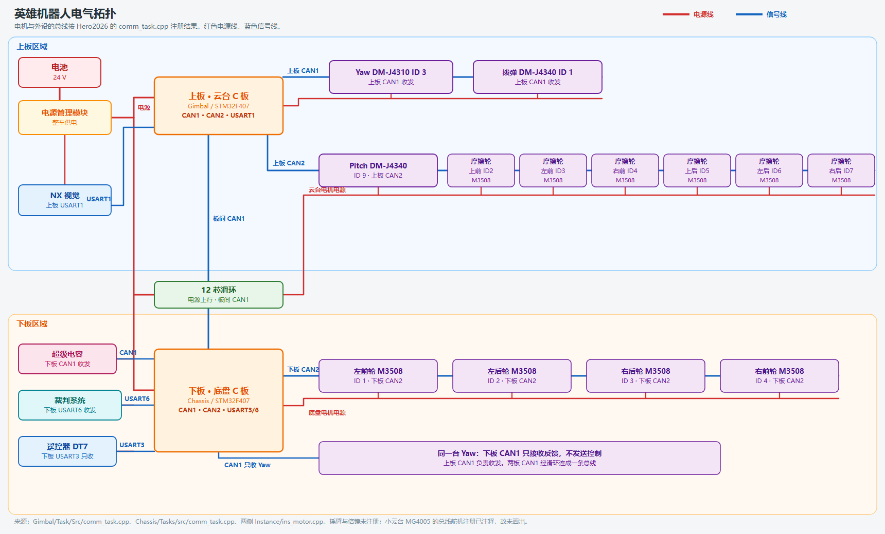

# 英雄机器人电气拓扑

红色是电源线，蓝色是信号线。

## 信号连接（代码）

| 位置 | 总线 | 设备 | 方向 |
| --- | --- | --- | --- |
| 下板 `hcan1` | CAN1 | 超级电容 | 收发 |
| 下板 `hcan1` | CAN1 | 与上板的板间通信 | 收发 |
| 下板 `hcan1` | CAN1 | Yaw，DM-J4310，ID 3 | 只收 |
| 下板 `hcan2` | CAN2 | 左前 / 左后 / 右后 / 右前轮，M3508，ID 1–4 | 收发 |
| 下板 `huart6` | USART6 | 裁判系统 | 收发 |
| 下板 `huart3` | USART3 | 遥控器 DT7 | 只收 |
| 上板 `hcan1` | CAN1 | 板间通信、Yaw ID 3、拨弹 DM-J4340 ID 1 | 收发 |
| 上板 `hcan2` | CAN2 | Pitch DM-J4340 ID 9 | 收发 |
| 上板 `hcan2` | CAN2 | 摩擦轮 M3508：上前 2、左前 3、右前 4、上后 5、左后 6、右后 7 | 收发 |
| 上板 `huart1` | USART1 | NX 视觉 | 收发 |

上下板的 CAN1 是同一条总线，经滑环相连。两块板各自的 CAN2 不互通。Yaw 只有一台：上板收发控制，下板只接收反馈。

电源线表示电池经电源管理模块给两块板、超级电容和各电机供电。
